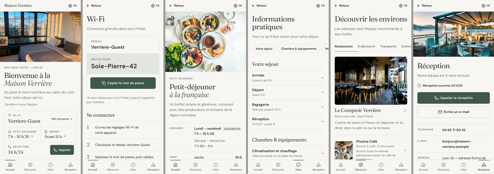
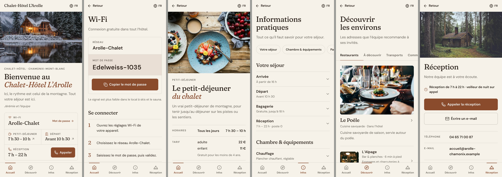

# Pristi Guest — prototype frontend

Livret d'accueil numérique pour hôtels indépendants : une expérience de conciergerie sobre, éditoriale et pensée pour le téléphone (le voyageur arrive par QR code).

> **Périmètre** : direction artistique, UX, navigation et interactions frontend uniquement. Aucun backend, aucune API métier, aucune authentification, aucun abonnement ni facturation. Le produit SaaS sera développé dans le dépôt principal `NameSolution/pristi`, qui n'est pas touché ici.
> Les deux hôtels présentés sont **fictifs** ; leurs informations (tarifs, numéros, mots de passe) sont des données de démonstration.




Autres captures : [`docs/screenshots/`](docs/screenshots) (bureau 1440 px, tablette 768 px, états interactifs).

## Lancer la prévisualisation

```bash
npm install
npm run dev          # http://localhost:5173 (accessible sur le réseau local, pour tester sur téléphone)
npm run build && npm run preview   # version de production sur :4173
```

| URL | Effet |
| --- | --- |
| `/` | Maison Verrière (boutique-hôtel urbain, Lyon) |
| `/?hotel=arolle` | Chalet-Hôtel L'Arolle (montagne, Chamonix) |
| `?preview=1` | Affiche la barre de bascule entre les deux hôtels (toujours active en `npm run dev`) |
| `?lang=en` | Force la langue (sinon : choix mémorisé, puis langue du navigateur) |

Le paramètre `hotel` est conservé sur tous les liens internes.

### Contrôles

```bash
npm test                          # tests unitaires (Vitest) : thème/contrastes, données, i18n, copie
npm run build && npm run qa       # captures, console, débordement horizontal, zones tactiles, 7 largeurs × 2 hôtels × 6 pages
node scripts/interactions.mjs     # parcours : copie Wi-Fi, QR, langue, accordéons, fiches, bascule d'hôtel
```

`qa` et `interactions` utilisent Playwright (Chromium) ; les captures sont écrites dans `qa-output/` (ignoré par Git). `QA_SHOTS=all` active toutes les captures, `QA_VIEWPORTS=390,1440` limite les largeurs.

## Écrans

| Route | Contenu |
| --- | --- |
| `/` | Accueil : photo, bienvenue, 4 accès immédiats (Wi-Fi, petit-déjeuner, départ, réception + appel direct), services du quotidien, sélection de proximité, index des rubriques |
| `/wifi` | Réseau, mot de passe lisible en grand, **copie en un geste** (avec repli si le presse-papiers est indisponible), étapes, QR de connexion |
| `/petit-dejeuner` | Fiche de service : horaires (jour courant mis en avant), tarif, lieu, buffet, bon à savoir. Les champs absents sont masqués |
| `/infos` | Informations pratiques en accordéons (séjour, chambre, accès, services, règlement, urgences), liens profonds `?go=checkout` |
| `/decouvrir` | Restaurants · À découvrir · Transports · Commerces & services, fiche détaillée par lieu, itinéraire uniquement quand l'adresse est connue |
| `/reception` | Appel, e-mail, disponibilité, langues parlées, poste interne |
| `/credits` | Crédits photographiques |

Mobile (< 1024 px) : en-tête compact de 56 px, barre inférieure à quatre entrées, contenu qui réserve toujours la hauteur de la barre.
Bureau (≥ 1024 px) : colonne photographique fixe (la photo change selon la page) + contenu à droite.

## Personnaliser un hôtel

Un seul modèle de composants ; tout ce qui change vit dans `src/data/hotels/<id>.js` (voir `verriere.js` et `arolle.js`, de même schéma, vérifié par un test) :

- `name`, `descriptor`, `logo` (optionnel — sinon le nom en typographie d'enseigne)
- `theme` : `accent`, `paper`, `ink`, `display` (`crisp` ou `soft`)
- `images` + `aside` : photos et photo de la colonne latérale par page
- `home.sections` : **ordre et visibilité** des blocs de l'accueil (A et B ont un ordre différent) ; `home.featured`
- `wifi`, `breakfast`, `stay`, `contact`, `services`, `info.groups`, `discover.places`
- `languages`, `weather` (optionnel)

Tout champ facultatif absent est simplement masqué. Les contrastes sont garantis par `src/lib/theme.js` : l'accent est assombri automatiquement s'il est trop clair pour le texte ou pour porter un libellé de bouton (testé).

Ajouter un hôtel : créer le fichier de données, l'enregistrer dans `src/data/hotels/index.js`, déposer ses photos dans `public/images/<id>/` en deux largeurs (`nom-640.webp`, `nom-1280.webp`).

## Structure

```
src/
  data/hotels/     données des établissements (séparées de l'interface)
  i18n/            dictionnaires par langue (clés stables guest.*) + résolution et repli
  lib/             thème/contrastes, formats, presse-papiers, sélecteurs, contexte d'hôtel
  components/      layout/ (cadre, nav, panneau de langue, aperçu) et ui/ (Photo, Sheet, Disclosure…)
  pages/           une page par route
  styles/index.css tokens, typographie, composants de base
scripts/           qa.mjs, interactions.mjs
docs/screenshots/  captures réelles
```

## Traductions

- **Français et anglais : complets** (interface et contenus de l'hôtel).
- **Espagnol, italien, allemand, portugais, polonais : interface traduite seulement** (navigation, accueil, Wi-Fi, titres de page, contacts). Les contenus propres à l'hôtel y retombent sur l'anglais, et le sélecteur de langue l'indique. Ces traductions n'ont pas été relues par un locuteur natif.
- Aucune API de traduction.

## Direction artistique

« Modern Hospitality » : éditorial haut de gamme + application mobile contemporaine. Papier ivoire (`#F7F6F2`), encre charbon, accent vert profond désaturé (`#40584C`) — ou terre cuite (`#8A4B2D`) pour la montagne. Titres en **Fraunces** (variable ; axes `SOFT`/`WONK` pilotés par l'hôtel, italique pour le nom de l'établissement), texte en **DM Sans**. Séparateurs fins plutôt que cartes ; une seule rangée de quatre accès regroupée dans un panneau ; rayons de 4 à 12 px ; ombres, dégradés, verre dépoli, carrousels et animations permanentes proscrits. Seules animations : fondu d'entrée de page (280 ms), ouverture des accordéons et des fiches ; tout est neutralisé avec `prefers-reduced-motion`.

## Ce qui a été conservé, supprimé, reconstruit

- **Conservé** : l'idée des trois grandes entrées (accueil / découvrir / contact), les rubriques Wi-Fi, petit-déjeuner, check-in/out, parking, FAQ → informations, recommandations locales, météo (réduite à une ligne discrète), les sept langues (principe de repli), React + Vite + Tailwind.
- **Supprimé** : tout le code, les contenus et les images propres à l'Hôtel Majestic de Lourdes ; le plugin d'édition visuelle Hostinger Horizons et ses scripts ; Leaflet/react-leaflet, Framer Motion, Embla, react-helmet, shadcn/Radix inutilisés, `class-variance-authority`, `tailwind-merge`, Babel, ESLint hérité ; les sections orphelines (`Acces`, `Equipements`, `Services`, `Urgences`, `Hotel`, `Sejour`…) ; la double couche de traduction (`contentConfig.js` + `locales/`) ; les images PNG de plus de 1 Mo ; les mentions « fonctionnalité en développement ».
- **Reconstruit** : tout le frontend (architecture, design system, pages, navigation, données, i18n, outillage de test). L'historique Git est intact.

## Composants externes et licences

| Composant | Usage | Licence |
| --- | --- | --- |
| React, React DOM | UI | MIT |
| React Router 7 | routage | MIT |
| Radix UI (`react-accordion`, `react-dialog`) | accordéons et fiches accessibles (focus, clavier, ARIA) | MIT |
| lucide-react | icônes | ISC |
| qrcode | QR Wi-Fi (chargé à la demande) | MIT |
| Fraunces, DM Sans (via `@fontsource-variable`, auto-hébergées) | typographie | SIL OFL 1.1 |
| Tailwind CSS, PostCSS, Autoprefixer, Vite, Vitest, Playwright | outillage | MIT / Apache-2.0 |
| Photographies d'illustration (Unsplash) | démonstration uniquement ; voir `src/data/credits.js` et `/credits` | licence Unsplash (usage commercial autorisé) |

Les composants shadcn/ui, 21st.dev et Motion Primitives n'ont **pas** été copiés : les composants nécessaires (accordéon, dialogue) reposent directement sur les primitives Radix, dont shadcn/ui est une surcouche, et le reste est écrit sur mesure.

## Limites connues

- Les photos sont des images d'illustration libres de droits, non des photographies des établissements fictifs ; certaines (randonnée, ski) ne représentent pas le lieu nommé. À remplacer par les photos de l'hôtel.
- La météo utilise l'API gratuite d'Open-Meteo, **réservée à un usage non commercial** : prévoir une offre commerciale ou un autre fournisseur pour le SaaS. En cas d'échec, rien n'est affiché.
- Pas de garde-fou de qualité d'image à l'import (photos supposées déjà recadrées/optimisées) ; pas d'éditeur hôtelier (hors périmètre).
- Les numéros et e-mails sont fictifs (plages réservées à la fiction / domaine `.example`) ; seuls 112, 15, 17, 18 et 3237 sont de vrais numéros.
- La liste de langues du sélecteur est identique pour les deux hôtels ; les traductions es/it/de/pt/pl ne couvrent que l'interface.
- Tests réalisés sur Chromium (Playwright) ; pas de test sur Safari iOS réel.
- Le routage utilise des URL propres (`BrowserRouter`) : l'hébergeur devra renvoyer `index.html` pour toute route inconnue.
